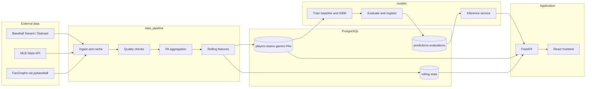

# System architecture

## High-level flow

## Module boundaries

| Layer | Responsibility | Location |
|-------|----------------|----------|
| Ingestion | Season/chunk downloads, cache keys, idempotent loads | `data_pipeline/ingest/` |
| Transform | PA identification, outcome taxonomy, typing | `data_pipeline/transform/` |
| Features | Chronological rolling windows, leakage guards | `data_pipeline/features/` |
| Persistence | SQLAlchemy models, Alembic migrations | `database/`, `backend/app/db/` |
| Modeling | Baseline + XGBoost multiclass, calibration | `models/` |
| Research | Coors-specific aggregates and charts | `research/`, API `coors/` |
| API | REST, Pydantic schemas, orchestration | `backend/app/` |
| UI | Six primary pages per spec | `frontend/src/` |

## Plate appearance modeling (Product A)

1. **Training unit:** One row per completed plate appearance with pre-PA features only.
2. **Target:** Multiclass outcome (K, BB, HBP, 1B, 2B, 3B, HR, other out).
3. **Models:** Baseline (empirical rates / naive Bayes style) vs gradient boosted trees with class probabilities.
4. **Aggregation:** Sum expected counts over hypothetical PAs for game-level lines; report calibrated probabilities and intervals.
5. **Evaluation:** Chronological split by game date; never random row splits.

## Coors Field research (Product B)

- Descriptive splits (home/away, park factors vs league) with filters.
- Regression or stratified comparisons when sample size allows; explicit non-causal language in UI copy.
- Precomputed materialized views or API queries over `plate_appearances` and `player_game_stats`.

## Run forecasting (Product C)

- Separate model using team offense, SP quality, bullpen proxies, park, home/away.
- Baseline: historical runs per game at park/season.
- Gated in UI until `model_evaluations` shows acceptable holdout metrics.

## Configuration

- Secrets and URLs: `.env` (see `.env.example`).
- Docker Compose runs Postgres + API + Vite dev server for local demos.
- Production model artifacts live under `models/artifacts/` (gitignored).

## Cross-cutting concerns

- **Logging:** Structured logs in pipeline and API.
- **Migrations:** Alembic revisions in `database/migrations/`.
- **Testing:** Leakage tests on feature builders; API integration tests with test DB.
- **Reproducibility:** Pinned dependencies in Docker images; `RANDOM_SEED` in env.
